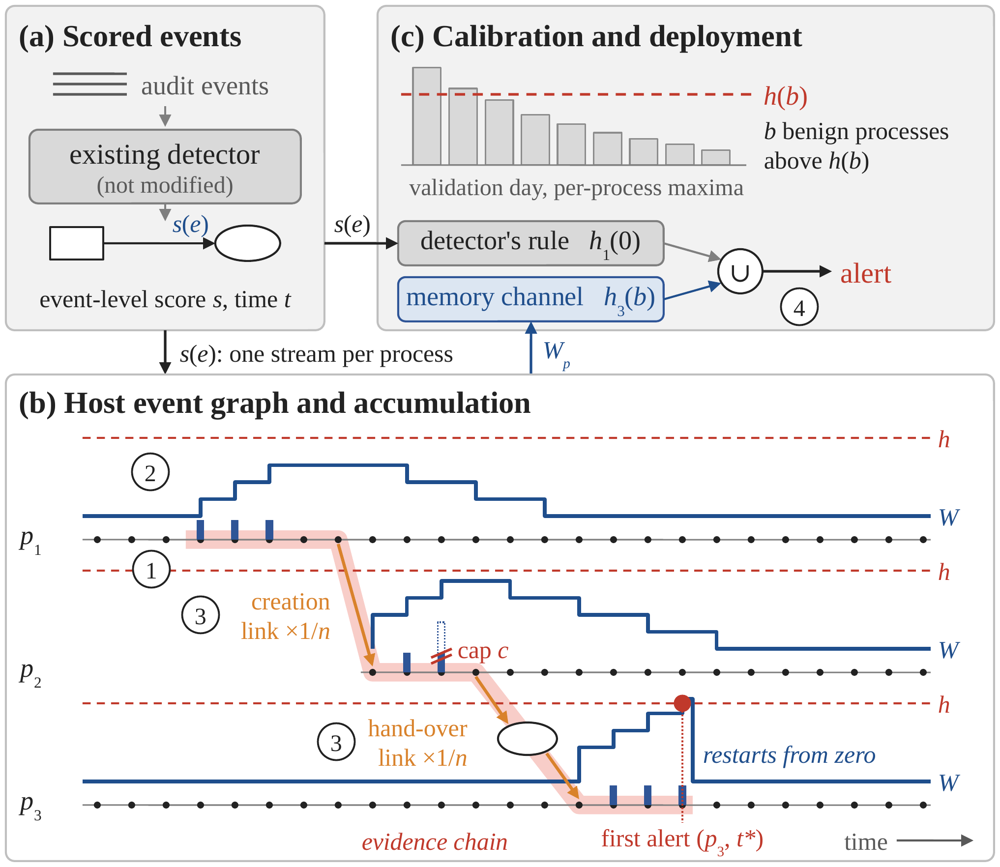

# FirstAlarm

Code and results for *Early Birds Catch Worms: Early Detection of Multi-Stage Intrusions via Evidence-Carrying Host Event Graphs* (submitted to IEEE ICASSP 2027; under review).

[](https://arxiv.org/abs/TBD)
[](LICENSE)



## Overview

A provenance-based intrusion detector scores every system event, and its alert rule then judges each score on its own, so the weak signals of an attack's first steps are discarded. FirstAlarm keeps the detector unchanged and adds memory to the alert rule. It accumulates the excess of each score over a baseline along the event stream of its process, as a cumulative sum that restarts after an alert; passes the sum, discounted, along process-creation and file/socket hand-over links; and raises an alert once a process's sum crosses a threshold set on one benign day. The detector's own rule keeps running beside this memory channel, so the first alert is never later than the detector's at its default threshold, and every alert returns the chain of events it rests on.

The evaluation protocol asks a question that detection-rate evaluations leave open: **how far has an attack progressed when the first alert on one of its processes is raised, under a false-positive budget calibrated on a benign day?** Progress is the fraction of the attack's malicious events already seen; a missed attack counts as complete.

With VELOX's per-event scores on DARPA TC E3 CADETS, at a budget of five benign processes per validation day, FirstAlarm raises a first alert on 14 of 15 attack–seed pairs against 9 for the detector's own rule, and the mean progress at the first alert falls from 52% to 27%. The gain does not carry over to THEIA, nor to the per-event scores of ORTHRUS or KAIROS; the numbers are in [Scope and negative results](#scope-and-negative-results).

## Layout

```
firstalarm/          the rules, calibration, replay and evaluation of the paper (protocol P1)
firstalarm/freeze/   the earlier code that produced the frozen inputs (scored streams, ground truth,
                     lineage), the self-check against VELOX's own alerts, and the Fig. 1 export
scripts/             replay, decomposition and diagnosis entry points; verify_numbers.py
configs/             budget grid, test days, switch settings, the two selection.json files
results/             every table, JSON and report the paper's numbers come from (Tier A input)
plots/               make_fig3_v4.py (Fig. 3), make_fig1_export.py and its event table (Fig. 1)
pidsmaker_patch/     one patch to PIDSMaker's TGN memory update, needed only to validate KAIROS/ORTHRUS
docs/                paper_numbers.md (paper number -> source), release_manifest.md,
                     PREREGISTRATION.md, RUN_LOG.md, REPRODUCE.md
data/                download.sh and SHA256SUMS for the frozen inputs (GitHub release)
```

`firstalarm/` is the implementation the paper reports. `firstalarm/freeze/` is kept because the frozen inputs cannot be rebuilt without it; its alert rules are an earlier version and are not the ones evaluated in the paper.

## Relation to PIDSMaker

FirstAlarm is a post-processing layer on top of [PIDSMaker](https://github.com/ubc-provenance/PIDSMaker) (Apache-2.0). PIDSMaker trains the detectors and writes one loss per test edge; FirstAlarm reads those per-event scores and never touches the model. All results use PIDSMaker at commit `84d9314bdd2cf6baad566cac12c222daf93e32b1`. PIDSMaker's own code is not redistributed here, with one exception: `pidsmaker_patch/` holds a small patch that chunks the TGN memory update at validation time so that KAIROS and ORTHRUS validate within 24 GB of GPU memory. It changes no result and is not part of PIDSMaker's `HEAD`.

The detectors whose scores we use:

- **VELOX** — T. Bilot, B. Jiang, Z. Li, N. El Madhoun, K. Al Agha, A. Zouaoui, T. Pasquier, "Sometimes Simpler is Better: A Comprehensive Analysis of State-of-the-Art Provenance-Based Intrusion Detection Systems," USENIX Security 2025.
- **ORTHRUS** — B. Jiang, T. Bilot, N. El Madhoun, K. Al Agha, A. Zouaoui, S. Iqbal, X. Han, T. Pasquier, "ORTHRUS: Achieving High Quality of Attribution in Provenance-based Intrusion Detection Systems," USENIX Security 2025. Its strict node-level labels are the ground truth throughout.
- **KAIROS** — Z. Cheng, Q. Lv, J. Liang, Y. Wang, D. Sun, T. Pasquier, X. Han, "KAIROS: Practical Intrusion Detection and Investigation using Whole-system Provenance," IEEE S&P 2024.

## Data

Experiments use the CADETS and THEIA hosts of [DARPA Transparent Computing Engagement 3](https://github.com/darpa-i2o/Transparent-Computing). Three CADETS attacks (6, 12, 13 April 2018) and two THEIA attacks (10, 12 April 2018); the validation day is 10 April for CADETS and 9 April for THEIA.

Reproducing the paper's numbers does not require the raw DARPA data. The archives are attached to the GitHub release icassp2027-submission and fetched by `data/download.sh`:

| Archive | Content | Uncompressed | Archive |
| --- | --- | --- | --- |
| `velox_streams_cadets.tar.zst` | VELOX scores, CADETS, five seeds, `.npz` + `.meta.json` per day | 715,120,890 B | 68,546,412 B |
| `velox_streams_theia.tar.zst` | same for THEIA | 1,498,986,655 B | 164,835,078 B |
| `frozen_labels.tar.zst` | both hosts' `groundtruth.json`, `lineage.json`, and `v9/<HOST>/selection.json` | 10,955,881 B | 2,519,858 B |
| `kairos_streams.tar.zst` | KAIROS scores aligned onto the CADETS VELOX event order (the `.npz` cache, not the edge-loss CSV) | 690,057,205 B | 88,299,432 B |
| `orthrus_streams.tar.zst` | ORTHRUS scores, same CADETS alignment | 690,057,205 B | 68,454,188 B |

A VELOX `.npz` holds `t, src, dst, etype, s, proc, obj, src_type, dst_type, proc_type, kind_i`; the program-name vocabulary is the sibling `.meta.json`. A KAIROS or ORTHRUS `.npz` has the same columns except `kind` (the program name itself) in place of `kind_i`, and no `.meta.json`. `data/README.md` documents units and provenance. The five archives together are 392,654,968 bytes.

## Install

Tiers A and B (below) need only Python 3.9+ and the packages in `requirements.txt`:

```bash
pip install -r requirements.txt
```

Tier C (re-training the detectors) needs PIDSMaker's own environment: follow its installation guide at the pinned commit, then apply `pidsmaker_patch/` before training KAIROS or ORTHRUS.

## Reproduce

Three tiers, from seconds to hours. `docs/REPRODUCE.md` has the full commands, expected outputs and timings.

Last verified: 2026-10-15, python:3.9-slim, Tier A and B.

**Tier A — check every number in the paper from the shipped results (seconds).**

```bash
python3 scripts/verify_numbers.py                         # asserts each entry of docs/paper_numbers.md
python3 plots/make_fig3_v4.py results/figA_reset_CADETS_E3.json
```

**Tier B — re-run the replay from the frozen scored streams (minutes, CPU only).**

```bash
bash data/download.sh                                     # five archives, checked against data/SHA256SUMS
export FA_ART_ROOT=$PWD/artifacts FA_DATA_ROOT=$PWD/data
python3 -m scripts.run_fa_v9    --scorer velox --rearm reset --pair selected,q99_kind
python3 -m scripts.run_fa_v9_3  --phase tables                                 # Table 1, per-cell CSV, Fig. 3 JSON
python3 -m scripts.run_fa_v9_3  --phase timing                                 # timing_single.json
python3 -m scripts.run_fa_v9_5  --scorer kairos --phase all
python3 -m scripts.run_fa_v9_8  --scorer orthrus --phase all
python3 -m scripts.decomp_v9_6  --phase all                                    # Q1-Q3 decomposition, placebo, F'
python3 -m scripts.diag_v9_11   --phase all                                    # after B.2 and B.3; see docs/REPRODUCE.md
python3 scripts/verify_numbers.py                                              # must pass against the regenerated results/
```

The replay runs at about 38k (CADETS) and 55k (THEIA) events per second in one process, all seven budgets at once.

**Tier C — re-train the detectors and rebuild the frozen streams (hours, GPU).**

Train VELOX in PIDSMaker (five seeds, 12 epochs, last saved epoch `model_epoch_11`) and cut the per-edge losses with `firstalarm.freeze.stream`, `firstalarm.freeze.lineage` and `firstalarm.freeze.groundtruth`. There is no `firstalarm.freeze.run` command. Training is not bit-reproducible across GPUs, and VELOX's authors report large seed-to-seed deviations, so Tier C reproduces the protocol, not the exact cells of Table 1; Tier B does. The install steps are in `docs/REPRODUCE.md`.

## Results at a glance

CADETS, budget b = 5, VELOX's scores, five seeds (Table 1 and Fig. 3 of the paper):

| Rule | Pairs with a first alert (of 15) | Earliness score E | Mean progress at first alert | Benign processes flagged per test day F |
| --- | --- | --- | --- | --- |
| Detector's own rule (D1) | 9 | 0.48 | 52% | 5.0 |
| Detector's own rule, relaxed to b = 20 | 10 | 0.55 | 45% | 15.0 |
| Memory channel alone (D3) | 12 | 0.60 | 40% | 12.0 |
| **FirstAlarm** | **14** | **0.73** | **27%** | 12.0 |

Against the detector at its default threshold, FirstAlarm alerts earlier on 4 pairs, at the same event on 4, and on 6 pairs where the detector raises no alert; it is never later. `docs/paper_numbers.md` maps every number in the paper to the file and line it comes from.

## Scope and negative results

The paper reports these limits; the repository holds the numbers behind them.

- **THEIA.** FirstAlarm 0.43 against 0.42 for the detector's rule at b = 5, with 20.0 against 10.7 benign processes per day. One benign validation day calibrates an accumulating rule poorly there: on four of five seeds the memory threshold equals at most two capped increments, and the programs that alert most on the test days (`firefox`, `fluxbox`) do not run on the validation day. See `results/THEIA_diag.md`.
- **ORTHRUS's scores (CADETS).** The event-level rule detects 5 of 15 pairs (E = 0.17); FirstAlarm detects 3 (E = 0.08). No gain. See `results/RESULTS_v9_8_orthrus.md`.
- **KAIROS's scores (CADETS).** The event-level rule detects 2 of 15 pairs; FirstAlarm none. See `results/RESULTS_v9_5_kairos.md`.
- **Why.** With VELOX's scores a median of 43% of an attack's malicious events lie above their baseline; with ORTHRUS's 33%, with KAIROS's 25%, and the accumulated sum never comes near the memory threshold. See `results/PERSIST_three_scorers.md`.

## Pre-registration

The ORTHRUS experiment was pre-registered: its success criterion was committed before the ORTHRUS models were trained, and the paper reports the outcome in the sentence fixed at that time. The KAIROS criterion was written down after the KAIROS replay. `docs/PREREGISTRATION.md` gives the timeline with commit hashes and timestamps.

## Citation

```bibtex
@misc{liu2027firstalarm,
  title  = {Early Birds Catch Worms: Early Detection of Multi-Stage Intrusions
            via Evidence-Carrying Host Event Graphs},
  author = {Liu, Chengliang and Zhang, Zhiwei and Wang, Fengshuan and Chen, Yingyu and He, Ji and Shen, Yulong},
  year   = {2026},
  note   = {Submitted to IEEE ICASSP 2027. Code and data: \url{https://github.com/Brsacher/ICASSP_early}}
}
```

## License

Apache-2.0, see `LICENSE`. `NOTICE` lists the upstream works and their licenses. The frozen scored streams on the GitHub release are derived from DARPA TC E3 and are released under CC-BY-4.0, following PIDSMaker's data release.

## Acknowledgements

PIDSMaker (ubc-provenance), the VELOX, ORTHRUS and KAIROS authors, and DARPA's Transparent Computing program made this work possible by publishing their code, labels and data. The cumulative-sum rule follows E. S. Page, "Continuous inspection schemes," *Biometrika*, 1954.

## Development note

The experiment code was written with the Cursor editor; the plotting scripts (`plots/`) and parts of this documentation were drafted with Claude (Anthropic) from the authors' data and notes. The authors verified every number against the files in `results/` (`scripts/verify_numbers.py`) and take responsibility for all content.
